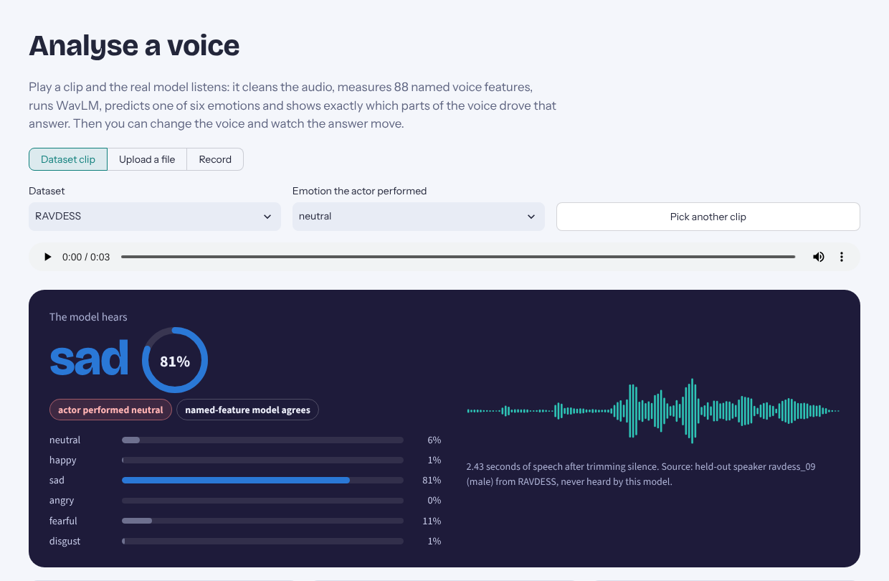

# Emotion Recognition Using Explainable Machine Learning

**Team Lucid** · Speech Emotion Recognition (SER) with Explainable AI

| Member | Roll number |
|---|---|
| Pranav Sajith | BL.SC.U4CSE24039 |
| Piriya Shreyash Shanmukh | BL.SC.U4CSE24037 |
| Praveen Raj | BL.SC.U4CSE24040 |

---

## About the project
We built a research-driven Speech Emotion Recognition system. It classifies emotion from voice recordings and **explains** which acoustic properties drove each prediction. We follow a literature-first workflow, so the research gap and methodology are chosen from evidence before any code is written.

**Research question:** When a speech emotion recognition model trained on one acted English corpus is applied to another, do its accuracy and its SHAP explanations hold up, and can explanation stability be used to choose features that transfer better?

**Workflow:** Literature → Research gap → Methodology → Data → Features → Models → Explainability → Experiments → Simulation → Report/Viva

## Current status
| Phase | Status |
|---|---|
| 1. Literature survey | ✅ Notes, matrix and synthesis complete |
| 2. Research gap & methodology | ✅ Direction approved — see [`report/02_research_gap_and_methodology.md`](report/02_research_gap_and_methodology.md) |
| 3. Dataset investigation | ✅ [`report/03_dataset_investigation.md`](report/03_dataset_investigation.md) |
| 4. Environment & repository | ✅ [`report/04_environment_and_repository.md`](report/04_environment_and_repository.md) |
| 5. Audio preprocessing & features | ✅ [`report/05_preprocessing_and_features.md`](report/05_preprocessing_and_features.md) |
| 6. Modelling | ✅ [`report/06_modelling.md`](report/06_modelling.md) |
| 7. Explainable AI | ✅ [`report/07_explainability.md`](report/07_explainability.md) |
| 8. Experiments & error analysis | ✅ [`report/08_experiments.md`](report/08_experiments.md) |
| 9. Interactive simulation | ✅ Streamlit app — see [`report/09_simulation.md`](report/09_simulation.md) |
| 10. Report & viva | ✅ Final report, presentation, viva preparation and learning guide — see below |

## Final deliverables (final review, November 2026)
| File | What it is |
|---|---|
| [`report/ieee/lucid_ieee_report.pdf`](report/ieee/lucid_ieee_report.pdf) | **Final report, IEEE conference format (8 pages)** (LaTeX source `report/ieee/lucid_ieee_report.tex`; figures and tables are generated by `report/ieee/make_figures.py` and `make_tables.py`) |
| [`report/Lucid_Final_Review.pptx`](report/Lucid_Final_Review.pptx) | Final presentation in the department format (Title, Abstract, Introduction, Problem statement, Objectives, Literature survey, Methodology, Block diagram, Implementation, Conclusion, References), with speaker notes |
| [`results/review/`](results/review/) | Train / validation / test scores for all 24 models, class separability, PCA and correlation analysis (`python -m src.review_analysis all`) |
| [`results/consolidated_results.md`](results/consolidated_results.md) | All results in one place, with train / validation / test metrics |
| [`report/Lucid_Final_Report.docx`](report/Lucid_Final_Report.docx) | Earlier long-form report (Markdown source [`report/10_final_report.md`](report/10_final_report.md)) |
| [`report/10_viva_preparation.md`](report/10_viva_preparation.md) | 55 examiner-style questions with answers |
| [`report/10_team_plan.md`](report/10_team_plan.md) | Ownership, shared-understanding sessions, submission checklist |

PDF files are git-ignored except the final report.

## Literature survey
- [`literature/literature_matrix.md`](literature/literature_matrix.md): comparison of the first 10 papers read (Phase 1); the final IEEE report and presentation use the 15 papers kept in `papers/` (table in both)
- [`literature/synthesis.md`](literature/synthesis.md): common methods, weaknesses and candidate research gaps
- [`literature/notes/`](literature/notes/): detailed notes on each paper

## Datasets (not included in this repository)
| Dataset | Speakers | Clips | Licence | Source |
|---|---|---|---|---|
| RAVDESS (speech, audio-only) | 24 | 1,440 (1,056 used: the 6 shared emotions) | CC BY-NC-SA 4.0 | https://zenodo.org/records/1188976 |
| CREMA-D | 91 | 7,442 | Open Database License | https://github.com/CheyneyComputerScience/CREMA-D |

Audio files are **not** committed. Download instructions: [`data/README.md`](data/README.md).

## Repository structure
```
literature/     literature matrix, synthesis, per-paper notes
notebooks/      01–07, run in order (data → features → models → XAI → experiments → evaluation → final model)
src/            reusable code: data, audio, features, models, evaluation, explain, experiments, predict, app helpers,
                voice adaptation (calibration, personal, augment, robust_features, voice_experiments)
data/           metadata and download instructions (raw audio and features stay local, git-ignored)
results/        figures and result tables for every phase
models/         trained models (local only, git-ignored; rebuilt by notebook 07 and src.app_assets)
app/            Streamlit demo application (.streamlit/ holds its settings)
report/         phase reports, final report, presentation, viva preparation, learning guide
```

## Setup (macOS)
```bash
git clone https://github.com/shreyashsp25/lucid-speech-emotion-xai.git
cd lucid-speech-emotion-xai
python3.11 -m venv .venv
source .venv/bin/activate
pip install -r requirements.txt
```

## Principles
- Speaker-independent evaluation (no speaker in both training and test data)
- No fabricated results, citations or novelty claims
- Explanations are evaluated, not just plotted

## Run the demo app



```bash
source .venv/bin/activate
python -m src.app_assets                         # once: held-out demo model (~3–5 min)
python -m src.robust_features train_aug          # optional, once (~40–60 min): simulated-microphone copies
python -m src.app_assets robust                  # optional, once (~20 s): microphone-robust model + its re-fit file
streamlit run app/streamlit_app.py
```
Needs the trained model from `notebooks/07_final_model.ipynb` and the local data (`data/raw`, `data/processed`).

What it does: predicts the emotion with the real model, explains it with exact SHAP (including **"Why angry and not happy?"**, the exact difference between two emotions), and shows the clip's waveform, energy and spectrogram. The Analyse page has two tabs, **Why** and **Signal**; the earlier version with six more tools (emotion compass, what-if studio, two-dataset lens, timeline, voice profile, stress test) was removed in November 2026. When two emotions score within 15 points it names both ("happy, or sad 36%") instead of pretending to be sure.

**Built for real voices, not just studio clips.** A laptop microphone makes normal speech sound *sad* to a model trained in recording studios, and excited shouting sounds *angry*. Four additions, each tested on speakers the models never heard ([`report/09_simulation.md`](report/09_simulation.md), sections 7–10; reproduce with `python -m src.voice_experiments calibration|corrections|robust|enrolment`):

| Addition | What it does | Tested gain |
|---|---|---|
| **Microphone-robust model** | trained on every clip twice: as recorded and through a random simulated microphone and room | +3 to +8 points on simulated laptop and phone mics, +15 to +18 in a far, echoey room; no loss on studio audio |
| **Calibrate to my voice** | three calm sentences become your baseline; recordings are judged by how they differ from *your* normal voice | UAR 69 → 77% (RAVDESS) and 72 → 75% (CREMA-D) on new speakers |
| **"Wrong answer?" corrections** | tell it what you really felt; it learns your voice in a few seconds | 3 corrections: +1 to +7 points; happy called angry 21% → 10% in an unfamiliar recording style |
| **Teach it your voice** | say each of the six emotions once; both models adapt to your voice (speaker adaptation) | higher UAR in all 10 tests, e.g. 78 → 85% (new RAVDESS speakers), 68 → 77% (unfamiliar recording style); dataset clips 80.5 → 86.9% (RAVDESS) |

The model has no *excited* label: excitement is learned as *happy* through corrections or teaching. All simulated conditions are simulations, not a user study.

**Something looks wrong?** Run `python -m src.selfcheck`. It replays 24 held-out clips through the same steps as the app, checks that the features computed on your computer equal the training features, and ends with a one-line verdict (also saved to `selfcheck_report.txt`). Recordings use the app's own raw-microphone recorder, which switches off the browser's automatic gain control and noise suppression.
