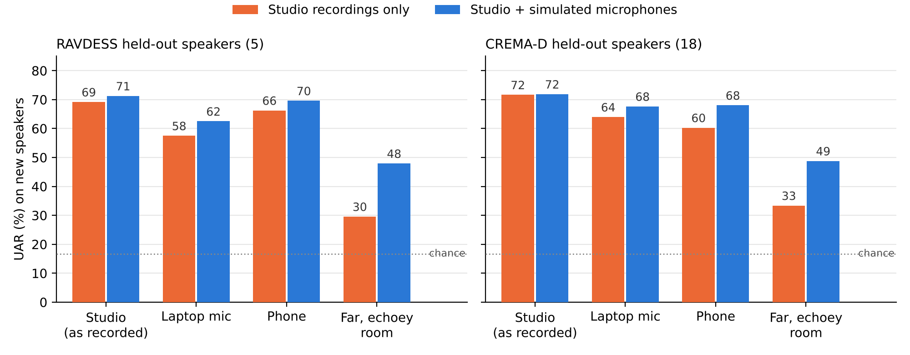

# Phase 9 — Interactive simulation (research demo app)

Team Lucid · `app/streamlit_app.py` (Streamlit + Plotly) · helpers in `src/app_utils.py`, `src/studio.py`, `src/app_assets.py`, `src/predict.py`.

## 1. How to run

```bash
source .venv/bin/activate
python -m src.app_assets                         # once, ~3–5 min: builds the held-out demo model
python -m src.robust_features train_aug          # once, ~40–60 min: simulated-microphone copies (section 9)
python -m src.app_assets robust                  # once, ~20 s: builds the microphone-robust model
streamlit run app/streamlit_app.py               # opens http://localhost:8501
```

The two robust steps are optional: without them, uploads and recordings use the studio model and
the app says so.

Needs `models/final_models.joblib` (from `notebooks/07_final_model.ipynb`), the cached features in `data/processed/` and the audio in `data/raw/` (for dataset examples). The first analysis takes about 20 s while openSMILE and WavLM load; after that each clip takes a few seconds.

## 2. What the app contains

**Look and navigation.** The app has its own visual identity ("Lucid voice emotion lab"): navigation across the top, a dark "console" panel that shows the predicted emotion in large type with a score ring, all six scores as bars, and the clip's own waveform trace; Bricolage Grotesque headings with Instrument Sans text; the same emotion colours as the report and slides.

| Page | Content | Source |
|---|---|---|
| **Analyse a voice** | Input: dataset clip (held-out speaker), file upload (WAV/FLAC/OGG/MP3) or microphone. Console with prediction, score ring, six score bars and waveform; three trust notes (recording conditions and calibration, typicality, second opinion); eight tabs (below) | live, real models |
| · Why | Exact linear SHAP of the eGeMAPS model for any chosen emotion; **"Why X and not Y?"**: the difference of two emotions' SHAP values, which is exactly how much each feature moves the log-odds of X over Y (starts on the runner-up emotion); plain-language summary; net evidence per feature group; share of the fusion model's evidence from eGeMAPS vs WavLM | live |
| · Emotion compass | The six scores placed on a pleasantness × energy circle; the clip's score-weighted position; after a stress test, every modified copy is added so the drift is visible | live |
| · What-if studio | Eight sliders (loudness, sound level, loudness attack, pitch, pitch movement, HNR, alpha ratio, speech rate) shift features in training standard deviations; the eGeMAPS model is recomputed exactly; "smallest single change" search that would turn the clip into another emotion | live, exact (linear model) |
| · Two-dataset lens | The same clip judged by three eGeMAPS models trained on RAVDESS only, CREMA-D only and both (fold-0 speakers always held out), each with its top three reasons: the Phase 8 cross-corpus effect on one clip | live, trained once per session |
| · Timeline | eGeMAPS model on 1-second windows every 0.25 s, drawn as stacked emotion scores above the energy curve | live |
| · Voice profile | Radar of eight named features as percentiles among the 8,498 training clips, against the median profile of any emotion; all 88 features on request | live |
| · Signal | Waveform + energy, STFT spectrogram, 64-band Mel-spectrogram, pitch contour (pYIN); duration, median pitch, pitch range, voiced share | live |
| · Stress test | Re-runs the whole pipeline on 6 modified copies (−12 / +6 dB, ±2 semitones, noise at 20 / 10 dB SNR) and shows the scores as a heat map | live |
| **How it decides** | Global SHAP top-15 per corpus and model; group shares (total and per feature); SHAP vs permutation agreement; RAVDESS-vs-CREMA-D importance scatter; per-emotion drivers; no-pitch shortcut check | Phase 7 results |
| **Performance** | All 12 model × feature results with fold SD; leakage experiment; interactive confusion matrices (out-of-fold); ROC-AUC, calibration, overfitting, learning curve; final-recipe held-out check | Phases 6, 8 (E6), 9 |
| **New-dataset test** | Cross-corpus UAR with bootstrap CIs and in-domain reference; H1 table; explanation stability (H2) box plots; stable-core selection (H3) forest plot; per-class drops, gender/age, label quality | Phase 8 |
| **About** | Pipeline diagram (reads the WavLM layer from the saved model), design choices, the interactive tools, limitations, ethics | — |

Every chart is drawn from the trained models or the saved result files; nothing is hard-coded or simulated.

**Honesty notes for the new tools.** The compass positions are a readable layout loosely following the valence–arousal arrangement used in psychology, not a measurement. The what-if studio moves one feature at a time, while real voices change several together, so it probes the model rather than creating a realistic voice. The timeline windows are shorter than the clips the model was trained on, so each window is rougher than the whole-clip result. All three caveats are written on screen.

## 3. Design decisions for honest predictions

1. **Real pipeline, verified.** The app calls the same `load_audio` → openSMILE → WavLM code as training. For a held-out RAVDESS clip, the features computed live in the app equal the stored training features (largest difference 0.00005, float rounding).
2. **Honest dataset demo.** The final model has heard every corpus clip, so playing one would overstate accuracy. `src/app_assets.py` trains the *same recipe* with all fold-0 speakers held out (5 RAVDESS + 18 CREMA-D speakers). Dataset examples come only from those speakers and use that model, so the true label is known **and** the speaker is new. On these speakers the recipe scored 72.5% (RAVDESS) and 72.3% (CREMA-D) UAR (Phase 9 notebook).
3. **"Model score", not "confidence".** Scores are shown as a score ring and six bars, with three trust notes underneath:
   - dataset clips: in-domain calibration is good (ECE 0.025 / 0.021, Phase 8 E6);
   - uploads and microphone: always warned that this is outside the training data, where cross-corpus UAR fell to 39–68% (Phase 8 E2) and scores are over-confident.
4. **Typicality check instead of a fixed threshold.** The first version warned when more than 10 of 88 features fell outside the 1–99% training range. Tested on the training clips themselves, that rule fired on **8.4% of RAVDESS clips**, too often to be useful. The app now ranks the clip against all training clips and warns only when it is more atypical than 95% of them.
5. **Two models, disagreement shown.** The prediction comes from the fusion model; the explanation from the interpretable eGeMAPS model. When the two disagree, the app says so rather than hiding it.
6. **Explanation caveats on screen.** Contributions are relative to the average training clip; correlated features (loudness and sound level) can get opposite signs; group-level evidence is more stable than single features (Phase 8, E3); SHAP shows association, not cause.

## 4. Stress test: why it is scientifically useful

Phase 7 found that the CREMA-D model relies on loudness (quiet → *sad*). Recording level also depends on the microphone and distance, not only on emotion. The simulation lets anyone check this live: if a copy 12 dB quieter flips the prediction to *sad*, the model is using recording level. Pitch shifts test reliance on speaker voice range (male vs female), and added noise tests recording quality. These are the same failure modes behind the cross-corpus drop in Phase 8.

## 5. Testing done

- Robust model and contrastive explanation (October 2026): in a headless browser with the real models, an uploaded recording went to the microphone-robust model (console tag and trust note shown), and the Why tab's "Compared with" box produced "Why happy and not disgust?" in both the plain and the calibrated view. No errors.
- Corrections (October 2026): in a headless browser, with the real models, a correction was taught after calibrating, the next upload used the personal model, "Forget corrections" restored the shared model, and without calibration the panel asks the user to calibrate first. No errors.
- Calibration (October 2026): both flows were run in a headless browser with the real models and real WavLM: a held-out RAVDESS clip with "Calibrate to this speaker" switched on, and an uploaded file after three calibration recordings were uploaded in Step 1 (simulated-microphone happy clip: happy 86% without calibration, happy 99% with it). No errors.
- October 2026 redesign: every page and all eight Analyse tabs were run in a headless browser on a test copy with the real saved models, real eGeMAPS features, real held-out RAVDESS and CREMA-D clips and the real `microsoft/wavlm-base-plus`; no errors. Checked: dataset clip, file upload, stress test (compass drift appears), what-if sliders, timeline, lens, a 400-pixel-wide phone layout. Example: a held-out RAVDESS neutral clip was called sad by the main model; in the two-dataset lens the RAVDESS-only model called it neutral while the CREMA-D-only and pooled models said sad.
- Earlier version: all five pages were rendered headless in a test copy of the project with the real Phase 6–9 result files and the real saved model; no errors on any page, tab or input mode (dataset example, random clip, file upload, robustness run).
- The test environment could not download WavLM weights, so it used a random stand-in for WavLM there; predictions shown in that test are therefore not meaningful. On the Mac the app uses the real `microsoft/wavlm-base-plus`.
- Pitch display: background hiss in the silent lead-in of some RAVDESS clips was being tracked as a flat 65 Hz "pitch"; frames pinned at the pitch-search floor are now dropped.

## 6. Live-demo plan (for the final assessment)

1. *Dataset clip* → CREMA-D → angry → show the console, then **Why** (loudness rising slope, sound level); set **Compared with** to *happy*: "why angry and not happy?" is the excitement question.
2. **What-if studio** → lower loudness attack and sound level → watch the answer move; show the smallest change that turns it sad.
3. **Two-dataset lens** → RAVDESS → neutral: the three training sources often disagree (our research question on one clip).
4. **Stress test** → then **Emotion compass** to show how far the copies drift.
5. *Record* → Step 1: three calm sentences to calibrate → Step 2: one sentence, happy then sad → compare the calibrated answer with "without calibration"; if it is wrong, use "Wrong answer?" to teach it, then record again.
6. **New-dataset test** → H1 chart and neutral collapse (recall 0.09).
7. **Performance** → leakage chart (why speaker-independent splits matter).

## 7. "Calibrate to my voice" (October 2026)

**Problem seen in use.** On a laptop microphone the app called normal speech *sad* and every loud
sentence, including excited shouting, *angry*. Two causes, both already measured in the project:
the model leans on loudness and sound level (Phase 7), and a new microphone, room and voice shift
every feature (Phase 8 domain shift). Excitement is also not one of the six trained emotions, so
the app now says that excited speech usually lands on angry or happy.

**Idea.** People judge emotion against a person's *normal* voice, not against an absolute scale.
The app now asks for three short recordings of the user's calm, normal voice (or, for a dataset
clip, uses three other neutral clips of the same held-out speaker) and judges each new recording
by how it differs from that baseline. This is per-corpus normalisation (Phase 8) done for one
speaker and one microphone.

**Method (`src/calibration.py`).**

- Baseline = mean eGeMAPS (88) and WavLM layer features of k = 3 neutral recordings of the speaker.
- Relative model: the same recipe as the final model (StandardScaler, clip at ±5, logistic
  regression, C = 0.01, balanced classes, eGeMAPS + WavLM fusion), trained on *clip − baseline*
  for every training speaker of both corpora. Each training speaker's baseline is the mean of
  3 randomly chosen neutral clips (seed 0), so the model learns to cope with a noisy baseline.
  A second relative model on eGeMAPS only (C = 1) gives the named-feature SHAP explanation
  ("compared with your normal voice: lower loudness, …").
- Calibrated answer = geometric mean of the original model's and the relative model's
  probabilities, renormalised. An emotion wins only if both models find it plausible.
- The relative models train in about 7 seconds the first time they are needed and are saved in
  `models/` (git-ignored). Dataset clips use a relative model trained without held-out fold 0.

**Evaluation (fusion, WavLM layer 7; the 3 baseline clips are removed from the test set;
mean of 10 random baseline draws; UAR in %). Reproduce with `python -m src.voice_experiments
calibration` (results/phase9/voice_calibration.csv).**

| Test | Original | Relative only | Arithmetic mean | **Geometric mean (used)** |
|---|---|---|---|---|
| Held-out speakers, RAVDESS fold 0 | 69.3 | 72.3 | 76.3 | **76.6** |
| Held-out speakers, CREMA-D fold 0 | 71.8 | 74.1 | 74.7 | **74.9** |
| Train RAVDESS → test CREMA-D | 42.3 | 41.2 | 49.1 | **51.7** |
| Train CREMA-D → test RAVDESS | 66.3 | 67.1 | 70.3 | **70.7** |

The RAVDESS fold-0 test has only 5 speakers (about 205 test clips), so its numbers move by a few
points with the random baseline choice (a first run with 3 draws gave 68.3 → 77.5).

**First microphone check (one speaker).** RAVDESS actor 9 (held out of both models) was
re-recorded in software: 150–6000 Hz band-pass, 0.3 s room reverb, −10 dB level and noise at
30 dB SNR. The baseline used 3 of the actor's 4 neutral clips (all 4 choices tried); 41 test
clips per choice. This check was run before the reproducible script existed; section 9 repeats
it on all fold-0 speakers and three simulated conditions.

| Recordings | Original | Relative only | Arithmetic mean | **Geometric mean (used)** |
|---|---|---|---|---|
| Studio (unchanged) | 66.7 | 82.3 | 85.9 | **84.9** |
| Simulated laptop microphone | 37.5 | 54.2 | 59.4 | **65.6** |

On the simulated microphone the original model called 71% of all clips *sad* and recognised no
neutral clip. The relative model alone over-corrected (sad recall 0.03). The geometric mean kept
most of both: neutral recall 0.50, sad 0.88, angry 1.00. It was chosen because it was equal or
better on every held-out test except the studio recordings (−1.0 point).

**Honest limits.**

- Simulated microphones are not a user study; real microphones vary more. Section 9 extends the
  test to all fold-0 speakers: with calibration the studio model rose from 57.5 to 69.7 (RAVDESS)
  and from 64.0 to 66.1 (CREMA-D) on a simulated laptop microphone.
- Calibration fixes the *baseline* shift, not the label set: excitement is still not an emotion
  the model knows.
- Sad vs neutral stays the hardest pair. In a single-clip check, a neutral sentence that was
  2 dB quieter than the three calibration recordings was still called sad (relative model:
  sad 50%, neutral 42%). The app therefore asks people to calibrate in the same room, with the
  same microphone and at the same distance.
- The baseline must really be calm speech; a baseline recorded while upset would shift every
  answer.

## 8. "That's wrong, I was …": learning from the user's corrections (October 2026)

**Problem seen in use.** Excited shouting came out as *angry*. There is no "excited" label, and
excitement and anger share what the features measure best: high pitch, loudness and fast
speech. Those cues measure how much energy a voice has, not whether it is positive or negative.
The actors' happy clips were never shouted, so the nearest training examples to excited
shouting are the angry ones. Calibration (section 7) cannot fix this; it moves the reference
point but does not teach the model what this person's excitement sounds like.

**Idea.** When the answer is wrong, the user says what they were really feeling ("happy /
excited", "neutral", …). The recording becomes a training example of *their* voice, and the
app re-fits in a few seconds.

**Method (`src/personal.py`).** The correction, expressed as a difference from the user's
calibrated normal voice, is added to the relative model's training data with its label and a
weight of 100 average training clips. Only the last logistic-regression layer is re-fitted,
starting from the shared weights; the scaling and clipping stay fixed. The original model is
not changed, and the answer is still the geometric mean of both models. Corrections need a
calibration and live only in the browser session.

**How it was tested.** For every held-out speaker, a simulated user goes through their clips in
random order. Whenever the calibrated answer is wrong, they correct it with the true label,
until m corrections have been made. Accuracy is then measured on that speaker's clips that come
*after* the last correction (never seen), and compared with no corrections on the same clips.
The baseline is 3 neutral clips, as in section 7. Fusion, layer 7, UAR in %.

*Choosing the weight* (fold-1 speakers, models trained on folds 2–4, 3 corrections, first
design that also re-fitted the original model):

| Weight | 10 | 30 | 100 | 300 |
|---|---|---|---|---|
| RAVDESS (72.1 without) | 75.3 | 74.0 | **76.0** | 71.8 |
| CREMA-D (77.6 without) | 79.1 | 79.0 | **78.7** | 78.0 |

Weight 100 had the best mean, so it was kept.

*First design rejected.* Re-fitting the original model as well helped on held-out speakers
(RAVDESS 75 → 88 after 5 corrections). But with a RAVDESS-trained model on CREMA-D speakers it
**hurt**: 52.0 → 42.4 after one correction, and still 46.7 with weight 10. A new speaker's
recordings sit together, far from the training data, so one correction pulled *all* of them
towards the corrected emotion. Relative features remove that per-speaker offset, so the final
design teaches only the relative model.

*Final design* (only the relative model learns, weight 100). Before → after on the same clips,
two random orders per speaker. Reproduce with `python -m src.voice_experiments corrections`
(results/phase9/voice_corrections.csv).

| Test | 1 correction | 3 corrections | 5 corrections |
|---|---|---|---|
| Held-out speakers, RAVDESS fold 0 | 75.4 → 76.2 | 75.5 → **82.7** | 74.4 → **84.5** |
| Held-out speakers, CREMA-D fold 0 | 74.7 → 75.6 | 74.0 → **76.3** | 72.9 → **74.9** |
| Train RAVDESS → test CREMA-D (30 speakers) | 52.1 → 52.1 | 51.6 → 52.6 | 51.3 → 51.9 |
| Train CREMA-D → test RAVDESS | 70.0 → 71.1 | 69.9 → **74.8** | 69.4 → **77.2** |
| … happy called angry (CREMA-D → RAVDESS) | 21% → 17% | 21% → **10%** | 24% → **12%** |
| … angry called happy (CREMA-D → RAVDESS) | 1% → 3% | 1% → 2% | 2% → 2% |

The CREMA-D → RAVDESS rows are the closest match to the excitement problem: a model meeting an
unfamiliar recording style and calling happy speech angry. Three corrections halved that error
without making real anger read as happy. (The rejected first design and the weight choice were
measured with an earlier version of the same simulation.)

**Honest limits.**

- No data set here has real excited speech, so excitement itself could not be measured. The
  test uses acted happy speech that the model mistook for anger.
- With a model facing a very different style (RAVDESS → CREMA-D) corrections neither helped nor
  hurt.
- A corrected recording may keep its old answer, because the original model still has a say.
  The app says so: corrections show their effect on the next recordings.
- Corrections teach *this* user's voice in *this* session; nothing is saved or shared.

## 9. Microphone-robust training (October 2026)

**Problem.** Calibration and corrections adapt to one user afterwards. The model itself had only
ever heard studio recordings, so a new microphone or room moved every feature before any
adaptation (Phase 8 domain shift, now on the microphone side).

**Method.**

- *Audio.* The original files were downloaded again from the official sources (RAVDESS from
  Zenodo, MD5 `bc696df6…` of `Audio_Speech_Actors_01-24.zip`; CREMA-D from its GitHub
  repository). Re-extracting 12 random clips reproduced the stored eGeMAPS features to within
  10⁻⁹ (relative) and the WavLM features with correlation 1.00000, so the pipeline is unchanged.
- *Simulated channels (`src/augment.py`).* Every training clip gets one random microphone and
  room, seeded by its file name: band-pass from 60–400 Hz up to 3–8 kHz; synthetic room echo
  (70% of clips, RT60 about 0.15–0.8 s, 20–70% wet); level change from −20 to +6 dB; white or
  pink noise at 10–40 dB SNR (85% of clips); clipping at full scale.
- *Fixed test conditions*, applied to the fold-0 speakers only:
  - **laptop**: 150–6000 Hz, short echo, −10 dB, white noise at 30 dB SNR;
  - **phone**: 300–3400 Hz, −6 dB, pink noise at 20 dB SNR;
  - **far room**: 1 s echo, 80% wet, −24 dB, *brown* noise at 15 dB SNR. This one lies partly
    outside the training ranges on purpose (longer echo, lower level, a noise colour never used
    in training).
- *Features* of every simulated clip go through the app's own extraction path
  (`src.predict.extract_one`). The one-off extraction (`python -m src.robust_features ...`) took
  about 0.25 s per clip on a 2-core CPU, for 8,498 training copies and 3 × 1,696 test clips.
- *Model.* Same recipe and settings as the final model (fusion, WavLM layer 7, logistic
  regression C = 0.01; explainer C = 1), trained on every training clip twice: as recorded and
  through its simulated channel. Nothing about the model changes except the training data.

**Evaluation** (folds 1–4 train, fold-0 speakers test; UAR in %; 95% interval of the gain from
1,000 speaker-level bootstrap resamples). Reproduce with `python -m src.voice_experiments robust`
(results/phase9/voice_robust.csv).



| Test speakers | Condition | Studio only | **+ simulated mics** | Gain [95% CI] |
|---|---|---|---|---|
| RAVDESS fold 0 (5) | studio | 69.2 | 71.3 | +2.1 [0.0, 5.4] |
| | laptop | 57.5 | 62.5 | +5.0 [−1.2, 11.2] |
| | phone | 66.3 | 69.6 | +3.3 [−7.1, 16.7] |
| | far room | 29.6 | **47.9** | **+18.3 [12.1, 27.1]** |
| CREMA-D fold 0 (18) | studio | 71.6 | 71.9 | +0.2 [−0.8, 1.2] |
| | laptop | 64.0 | **67.6** | **+3.7 [1.6, 5.6]** |
| | phone | 60.3 | **68.0** | **+7.8 [4.3, 11.1]** |
| | far room | 33.4 | **48.8** | **+15.4 [10.5, 20.2]** |
| Train RAVDESS → test CREMA-D | studio | 42.3 | 41.9 | −0.4 [−1.7, 0.8] |
| Train CREMA-D → test RAVDESS | studio | 66.3 | 64.5 | −1.8 [−4.7, 1.2] |

How often neutral speech was called *sad* (studio-only → robust): CREMA-D laptop 17% → 4%,
phone 14% → 2%, far room 25% → 14%; RAVDESS laptop 55% → 50%, phone 40% → 20%, far room
85% → 55%. In the far room, happy speech called angry fell from 30% to 6% (CREMA-D).

**Together with calibration** (mean of 3 baseline draws, baseline recorded through the same
simulated microphone):

| Test speakers | Condition | Studio only + calibration | **Robust + calibration** |
|---|---|---|---|
| RAVDESS fold 0 | studio | 75.8 | 75.7 |
| | laptop | 69.7 | **71.1** |
| | phone | 66.4 | **70.6** |
| | far room | 40.0 | 38.3 |
| CREMA-D fold 0 | studio | 75.1 | 75.0 |
| | laptop | 66.1 | **68.3** |
| | phone | 65.3 | **69.0** |
| | far room | 39.9 | **45.1** |

**Decision.** The robust model is better or equal under every simulated microphone and costs
nothing on studio audio, so the app now uses it for uploads and recordings
(`models/final_models_robust.joblib`, built with `python -m src.app_assets robust`). Dataset clips
keep the held-out studio model, because they are studio recordings and their numbers are the
ones reported in Phases 6–9.

**Honest limits.**

- All conditions are simulated. They are built to resemble cheap microphones and rooms, but a
  real laptop, phone or room can differ in ways the simulation does not cover (automatic gain
  control, noise suppression, compression codecs).
- On the 5 RAVDESS test speakers only the far-room gain is clearly above zero; the laptop and
  phone intervals include zero.
- Across data sets on clean audio the robust model is slightly, not significantly, worse
  (−0.4 and −1.8 points).
- In the far room, calibration did not help the robust model (RAVDESS 47.9 without, 38.3 with).
  The relative model was trained on studio audio only; heavy echo blurs the differences it
  relies on. Training a relative model on simulated channels needs each speaker's clips to share
  one channel, which our per-clip augmentation does not provide (future work).

## 10. Limitations

- Microphone recordings are out-of-domain; the app's scores for them are rough, as stated on screen. Calibrating to the user's voice (section 7) and correcting its mistakes (section 8) reduce but do not remove this.
- Microphone robustness was tested on simulated conditions only (section 9).
- The six emotions are acted categories; excitement, boredom and many everyday feelings are not among them.
- The explanation is for the eGeMAPS model; the fusion model's WavLM part (most of its evidence) has no human-readable names, which the app shows explicitly as the eGeMAPS vs WavLM evidence share.
- Runs locally only (needs the trained model, features and audio). It is a research demo, not a product.
